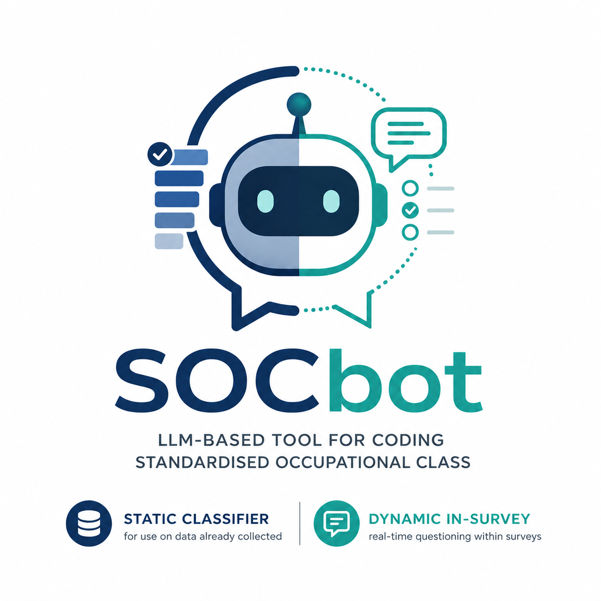

<p align="center">
  
</p>

# SOCbot — Flask service for real-time SOC classification

SOCbot is an LLM-powered tool for assigning UK Standard Occupational
Classification (SOC2020) codes to survey responses, with two operational
modes:

- **Static** — code occupation responses already collected (offline batch).
- **Dynamic** — embed in a survey instrument so each respondent's job title
  is classified in real time, with the LLM generating tailored follow-up
  questions whenever the initial answer is too ambiguous to code with
  confidence.

The companion paper describes the design and reports inter-coder
reliabilities against expert human coders on two UK survey samples
(Public Voice $n=2{,}000$ and Next Steps $n=5{,}162$), plus a live
field test ($n=1{,}077$). Reliabilities are comparable to the upper end
of published human inter-coder benchmarks.

> Sturgis, P., Robinson, T.S., Fung, L., & Roberts, C. (2026). *SOCbot:
> Using Large Language Models to Dynamically Measure and Classify
> Occupations in Surveys.* Sociological Methods & Research (OnlineFirst).
> <https://doi.org/10.1177/00491241261461516>

---

## What this repository contains

```
soc_flask/
├── app.py                 # the Flask service (classify + followup endpoints)
├── manage_keys.py         # interactive CLI for storing API keys in the OS keyring
├── example_call.py        # minimal Python client demonstrating the dynamic loop
├── api_docs.md            # full endpoint reference (request shape, response shape)
├── index_prompt.md        # the SOC2020 code list rendered for LLM context
├── static/
│   ├── followup_prompt.txt   # operational system prompt (default — supports follow-ups)
│   └── force_classify.txt    # variant that forces a code with no further follow-ups
├── soc_2020.csv           # SOC2020 lookup (extended)
├── soc_2020_4d.csv        # SOC2020 lookup (4-digit unit groups only)
├── requirements.txt
├── .env.example           # template — copy to .env and fill in keys
└── testing/               # batch-test harness and sample inputs
```

---

## Quick start

### 1. Clone and install

```bash
git clone https://github.com/tsrobinson/soc_flask.git
cd soc_flask
python -m venv .venv && source .venv/bin/activate
pip install -r requirements.txt
```

Tested on Python 3.10–3.12.

### 2. Configure provider keys

SOCbot can call OpenAI, Anthropic, and any OpenAI-compatible provider
(currently wired up for Groq and Together AI). It also uses Pinecone for
the retrieval shortlist by default. Supply each key by either:

**Option A — `.env` file** (simplest for one-shot or container use):

```bash
cp .env.example .env
# edit .env and fill in the keys you actually need
```

**Option B — OS keyring** (recommended for local development; keys never
appear in plaintext on disk):

```bash
python manage_keys.py            # interactive menu
python manage_keys.py set OPENAI_API_KEY
python manage_keys.py list
```

The keyring is shared across processes via `keyring`'s OS backend
(macOS Keychain / Linux Secret Service / Windows Credential Manager),
so once a key is stored you can run the Flask app and any helper scripts
without re-entering it.

Loading precedence at startup is **environment variable → OS keyring →
absent** (treated as that provider unavailable). Only the providers you
actually need have to be configured.

### 3. Set an access token

The two `/api/*` endpoints require a shared bearer token. Set it in the same
`.env` (or environment) as the provider keys:

```bash
SOCBOT_API_TOKEN=$(python -c "import secrets; print(secrets.token_urlsafe(32))")
```

Clients then send it on every request:

```
Authorization: Bearer <token>
```

With no token configured the API refuses all requests with `503` rather than
running open — the endpoints are otherwise unauthenticated and would relay to
your provider accounts for anyone who knows the URL. `/hello/` stays open so
health checks keep working.

Optionally, restrict which models callers may name:

```bash
SOCBOT_ALLOWED_MODELS=gpt-4o-mini-2024-07-18,o4-mini-2025-04-16
```

Unset, any model is accepted. Requests naming a model outside the list get a
`400`.

Note that the token authenticates the *caller*, not a provider — clients need
no OpenAI or Pinecone account of their own.

### 4. Run the service

```bash
flask --app app run --port 8000
# or:  python app.py
```

The service exposes three endpoints:

| Method | Path             | Purpose                                                       |
|--------|------------------|---------------------------------------------------------------|
| GET    | `/hello/`        | Health check                                                  |
| POST   | `/api/classify`  | Static one-shot classification (always returns a SOC code)    |
| POST   | `/api/followup`  | Dynamic classification (may return a SOC code OR a follow-up) |

See [`api_docs.md`](api_docs.md) for the full request/response contract,
including optional fields and rate limiting.

### 5. Try it

```bash
python example_call.py
```

The example client simulates a respondent: it asks for a job title,
sends it to `/api/followup`, prints any follow-up question it gets back,
collects your answer, and loops until SOCbot returns a final code.

---

## Supported models

Provider routing is name-prefixed in the `model` field of the request
JSON, so you can switch models without changing the API contract:

| Model name pattern              | Provider                     | Examples                                  |
|---------------------------------|------------------------------|-------------------------------------------|
| `gpt-*`, `o3*`, `o4-*`, `text-*`| OpenAI                       | `gpt-5`, `o3`, `o4-mini-2025-04-16`       |
| `claude-*`                      | Anthropic                    | `claude-opus-4-6`, `claude-sonnet-4-6`    |
| `groq/<id>`                     | Groq (OpenAI-compatible)     | `groq/llama-3.3-70b-versatile`            |
| `together/<id>`                 | Together AI (OAI-compatible) | `together/openai/gpt-oss-120b`            |

All four providers run through the same classification logic and parser,
so cross-model comparisons hold the prompt and shortlist fixed.

---

## Retrieval (Pinecone)

By default the service generates an embedding from the respondent's
initial answer (OpenAI `text-embedding-3-large`, 3072-dim) and queries a
Pinecone index for the top-$k$ candidate SOC codes. The expected index
is **`soc4d`**, populated with the 412 SOC2020 4-digit unit-group titles
from `soc_2020_4d.csv`. This is the index used for every result in the
companion paper.

To populate the index from scratch, embed `soc_2020_4d.csv` with the
OpenAI embeddings API and upsert into Pinecone — see the paper's
replication package for a worked example. The extended SOC2020 schema
(`soc_2020.csv`) and the 31,924-row job-title aliases from the SOC2020
coding-index volume can be used as alternative retrieval bases instead
(see the `index == "job-titles-4d"` branch in `app.py`), but they are
not used in any of the paper's reported results.

If you don't want to use Pinecone, you can pre-compute candidate codes
yourself and pass them through the request's optional `soc_cands`
field; the service will skip the embedding/retrieval step entirely.
This is how the offline batch reruns in the paper (workstream B)
operate.

---

## Integrating into a survey instrument

The dynamic flow assumes the survey scripting software can:

1. Capture the respondent's initial job-title answer.
2. POST it to `/api/followup`, with the access token in an
   `Authorization: Bearer <token>` header.
3. Inspect the response: if `followup` starts with the marker
   `CGPT587:`, the SOC code in `soc_code` is final; otherwise show the
   `followup` text to the respondent as the next question.
4. On follow-up answers, append `(question, answer)` pairs to
   `additional_qs` and resend with the same `soc_cands` (echoed from
   the previous response, so the shortlist remains stable across
   turns).
5. Loop until a code is returned, or until you hit a configurable
   probe-count cap — at which point switch the request's `sys_prompt`
   to `force_classify.txt` to force a final code.

The reference Python client in `example_call.py` shows this loop end
to end. Most survey platforms (Qualtrics, SurveyCTO, ODK,
Lighthouse, etc.) can drive it via their HTTP request hooks.

---

## Testing

Batch-test the classifier against the included `job_titles.json` fixtures:

```bash
cd testing
./test_classify.sh    # writes to testing/test_results/
```

`testing/batch_requests.py` is a more flexible alternative for sending a
custom CSV through the API in parallel.

---

## Citation

If you use SOCbot or any of its components in published work, please
cite the paper:

```bibtex
@article{sturgis_socbot_2026,
  author  = {Sturgis, Patrick and Robinson, Thomas S. and Fung, Laura and Roberts, Caroline},
  title   = {{SOCbot}: Using Large Language Models to Dynamically Measure and Classify Occupations in Surveys},
  journal = {Sociological Methods \& Research},
  year    = {2026},
  doi     = {10.1177/00491241261461516},
  url     = {https://doi.org/10.1177/00491241261461516},
  note    = {OnlineFirst, published 29 June 2026.}
}
```

The article is open access under CC BY-NC 4.0. Volume, issue and page
numbers are not yet assigned -- update the entry once it appears in an
issue.

The replication code for every figure and table in the paper is in the
companion replication package; see the paper's data-availability
statement for the link.

---

## License

TBD — see `LICENSE` once added. Until a licence is published, all
rights are reserved by the authors; please contact us before
redistributing or building on the code.

## Issues and contact

Bug reports and feature requests via GitHub Issues. For substantive
research enquiries — methodological questions, integration help, joint
work — please contact the authors directly.
